# LAPORAN TUGAS PROJECT-BASED LEARNING (PBL)
## SOFTWARE QUALITY ASSURANCE (SQA) — ASSIGNMENT 8
### AUTOMATED END-TO-END (E2E) TESTING & CONTINUOUS INTEGRATION (CI) PIPELINE

---

| Informasi Dokumen | Detail |
| :--- | :--- |
| **Mata Kuliah** | Software Quality Assurance (Penjaminan Mutu Perangkat Lunak) |
| **Institusi** | Jurusan Teknologi Informasi — Politeknik Negeri Malang (Polinema) |
| **Semester** | Ganjil 2026 / 2027 |
| **Sub-CPMK** | **SCPMK0608-04203**: Mampu merancang, membangun, dan mengeksekusi automated End-to-End (E2E) tests pada critical software workflows dan mengintegrasikannya ke dalam CI/CD pipelines |
| **Nama Proyek PBL** | **ActiveHub** (Platform Reservasi Fasilitas Lapangan & Komunitas Olahraga) |
| **Repositori GitHub** | [https://github.com/tiara082/activehub](https://github.com/tiara082/activehub) |
| **Path Berkas CI** | `.github/workflows/playwright.yml` |
| **Path Berkas E2E Test** | `e2e/tests/` & `e2e/pages/` |

---

## DAFTAR ISI
1. [Ringkasan Eksekutif & Identitas Proyek](#1-ringkasan-eksekutif--identitas-proyek)
2. [Arsitektur Pengujian & Posisi E2E dalam Testing Pyramid](#2-arsitektur-pengujian--posisi-e2e-dalam-testing-pyramid)
3. [Pemilihan Critical User Journeys (Core Business Value)](#3-pemilihan-critical-user-journeys-core-business-value)
4. [Arsitektur Page Object Model (POM)](#4-arsitektur-page-object-model-pom)
5. [Strategi Resilient Locators & Web-First Assertions](#5-strategi-resilient-locators--web-first-assertions)
6. [Manajemen Test Data, State Isolation & Storage State](#6-manajemen-test-data-state-isolation--storage-state)
7. [Integrasi CI Pipeline Menggunakan GitHub Actions](#7-integrasi-ci-pipeline-menggunakan-github-actions)
8. [Observability, Debugging & Trace Viewer](#8-observability-debugging--trace-viewer)
9. [Panduan Langkah Pengambilan Screenshot (Screenshot Instructions)](#9-panduan-langkah-pengambilan-screenshot-screenshot-instructions)
10. [Hasil Eksekusi & Bukti Screenshot](#10-hasil-eksekusi--bukti-screenshot)
11. [Kesimpulan & Checklist Evaluasi](#11-kesimpulan--checklist-evaluasi)

---

## 1. Ringkasan Eksekutif & Identitas Proyek

**ActiveHub** adalah aplikasi web berbasis Laravel yang dirancang untuk mengatasi hambatan dalam ekosistem reservasi gelanggang olahraga dan komunitas olahraga (Futsal, Sepak Bola, Badminton, Bola Basket). Platform ini memfasilitasi dua peran utama:
1. **Pemain (User)**: Menjelajahi katalog venue olahraga, memeriksa ketersediaan jam/lapangan secara real-time, melakukan pemesanan lapangan, bergabung dalam *Public Match*, dan melakukan pembayaran digital aman (Midtrans Snap & QRIS).
2. **Pemilik Fasilitas (Owner)**: Mengelola jadwal lapangan, mengatur blokir jam operasional, mencatat transaksi *offline*, dan memonitor pendapatan sewa.

Tujuan utama dari pengujian End-to-End (E2E) pada tugas ini adalah memberikan **Highest Business Confidence** bahwa alur bisnis kritis (*critical revenue-generating user journeys*) berfungsi secara harmonis tanpa cacat dari perspektif pengguna nyata (*real-user perspective*).

---

## 2. Arsitektur Pengujian & Posisi E2E dalam Testing Pyramid

### 2.1 Posisi dalam Piramida Pengujian (Mike Cohn / Martin Fowler)
Dalam disiplin rekayasa mutu perangkat lunak, arsitektur pengujian disusun secara berjenjang untuk mencegah timbulnya biaya tinggi dan kerapuhan sistem (*flakiness*):

```
                   /\
                  /  \
                 / UI \
                /  E2E \       <-- Peak (10%): Validasi Critical User Journeys
               /--------\                      (Playwright Tests)
              / Integrasi\     <-- Middle (20%): Kontrak Antar Modul, Controller,
             /    API     \                      Database Query, Midtrans Callback
            /--------------\
           /      Unit      \  <-- Base (70%): Logika Bisnis Terisolasi, Enkripsi,
          /      Tests       \                 Normalisasi No HP, Validasi Input
         /--------------------\
```

* **Unit Tests (~70%)**: Berjalan dalam fraksi milidetik, memvalidasi fungsi murni seperti format normalisasi nomor HP (`normalisePhone`) dan aturan validasi request tanpa dependensi browser.
* **Integration Tests (~20%)**: Memverifikasi interaksi antar-komponen, rute, database migrations, dan gateway payment.
* **E2E Tests (~10%)**: Berada di puncak piramida. E2E mengemudikan browser secara nyata (Chromium/WebKit/Firefox) melintasi keseluruhan tumpukan (*Full-Stack Multi-Layer Scope*): Frontend Blade/Tailwind UI -> Controller -> Middleware Auth -> MySQL Database -> State UI Response.

### 2.2 Pencegahan Anti-Pattern *Testing Ice Cream Cone* & *Shift Left*
Mengabaikan pengujian unit/integrasi lalu menumpuk ratusan skenario E2E di tingkat UI memicu anti-pattern **Testing Ice Cream Cone**. Dampak buruknya adalah:
* Waktu eksekusi CI menjadi sangat lambat (berjam-jam).
* Tingginya *alert fatigue* akibat *network glitches* atau perubahan kosmetik CSS mikro.

Sesuai prinsip **Shift Left**, logika logika validasi form dites sedini mungkin pada lapisan unit/fitur, sementara suite E2E Playwright dikhususkan secara disiplin untuk skenario *Happy Path* dan *Negative Path* pada alur transaksi utama.

### 2.3 Justifikasi Pemilihan Microsoft Playwright
Berdasarkan analisis komparatif perkakas pengujian modern:
* **Playwright vs Cypress**: Playwright mendukung arsitektur multi-origin, multi-tab, integrasi native Chromium/Firefox/WebKit tanpa plugin eksternal, auto-waiting cerdas berbasis event loop browser, serta tidak mengalami masalah memori browser pada eksekusi skala besar.
* **Playwright vs Selenium**: Selenium membutuhkan driver perantara (*third-party WebDriver*) dan rentan *flaky* akibat ketiadaan polling DOM otomatis tanpa custom wrapper sleep. Playwright bekerja melalui koneksi WebSocket langsung ke Chrome DevTools Protocol (CDP), menghasilkan eksekusi headless yang jauh lebih cepat dan deterministik.

---

## 3. Pemilihan Critical User Journeys (Core Business Value)

Sesuai panduan tugas PBL, dipilih **2 Critical User Journeys** utama yang mewakili nilai bisnis inti (*core business value*) platform ActiveHub:

```mermaid
flowchart TD
    subgraph Flow 1: User Onboarding & Auth
        A[Kunjungi /register] --> B[Isi Form Registrasi Lengkap]
        B --> C[Submit Akun Baru]
        C --> D[Redirect ke /login dengan Flash Pesan]
        D --> E[Input Email/HP & Password]
        E --> F[Redirect ke /user/dashboard]
    end

    subgraph Flow 2: Main Transaction Booking
        G[Autentikasi User Sesi Aktif] --> H[Buka Katalog /venues]
        H --> I[Pilih Detail Venue Olahraga]
        I --> J[Pilih Jadwal Jam Lapangan]
        J --> K[Klik Tombol Pesan]
        K --> L[Landing di Halaman Checkout /payment/:id]
        L --> M[Validasi Rincian Lapangan & Harga]
        M --> N[Pilih Metode Pembayaran QRIS/Snap]
    end
```



### Flow 1: Registrasi Akun & Autentikasi Pengguna (*User Onboarding & Authentication Flow*)
* **Justifikasi Nilai Bisnis**: Tanpa proses pendaftaran dan otentikasi yang andal, pengguna tidak dapat mengakses fitur transaksional maupun menyimpan riwayat permainan. Alur ini memvalidasi gerbang akses kontrol sistem, *password hashing*, dan proteksi rute (`guest` vs `auth` middleware).
* **Skenario yang Diuji**:
  1. *Positive Path*: Pendaftaran pengguna baru dengan data deterministik dinamis (`timestamp`), redirect ke halaman login, kemudian otentikasi masuk hingga mendarat di `/user/dashboard`.
  2. *Negative Path*: Percobaan login menggunakan kredensial tidak valid dan verifikasi kemunculan pesan error tanpa mengalami *crash* aplikasi.

### Flow 2: Pencarian Venue, Pemilihan Jadwal, & Transaksi Pemesanan Lapangan (*Main Transaction Flow*)
* **Justifikasi Nilai Bisnis**: Ini merupakan **Core Revenue Stream** (*money flow*) ActiveHub. Keberhasilan bisnis platform bergantung penuh pada kelancaran alur dari eksplorasi venue, pemilihan slot waktu kosong, pembuatan entitas reservasi di database (`bookings`), hingga tersajikannya lembar pembayaran (*checkout page*) lengkap dengan rincian biaya dan opsi pembayaran digital (Midtrans/QRIS).
* **Skenario yang Diuji**:
  1. Pengguna terotentikasi membuka halaman direktori venue `/venues`.
  2. Memilih venue olahraga target (misal: Champion Futsal).
  3. Memilih slot waktu bermain yang tersedia (`.schedule-card`).
  4. Menekan tombol "Pesan" untuk mengirim form reservasi ke `/venues/book`.
  5. Memvalidasi bahwa pengguna diarahkan ke `/payment/{booking}` dengan status pemesanan terkonfirmasi, data venue/lapangan sesuai, dan opsi pembayaran QRIS dapat diakses.

---

## 4. Arsitektur Page Object Model (POM)

### 4.1 Konsep dan Manfaat POM
**Page Object Model (POM)** adalah pola desain perangkat lunak yang memisahkan antara representasi teknis antarmuka halaman web (locators & aksi dasar) dari logika skenario bisnis pengujian (*test specs*).
* **Penerapan Prinsip DRY (*Don't Repeat Yourself*)**: Bila terdapat pembaruan atribut UI (misal: teks tombol atau ID input berubah), perbaikan cukup dilakukan pada satu kelas Page Object tanpa harus mengubah puluhan file skenario pengujian.
* **Readability Tinggi**: Skenario pengujian terbaca seperti bahasa natural manusia (`await loginPage.login('user@email.com', 'pass')`).

### 4.2 Struktur Direktori Proyek
```text
activehub/
├── .github/
│   └── workflows/
│       └── playwright.yml         # Konfigurasi Otomasi CI Pipeline
├── e2e/
│   ├── pages/                     # Direktori Page Object Classes
│   │   ├── BasePage.ts            # Kelas Induk: Navigasi & Web-First Assertion URL
│   │   ├── RegisterPage.ts        # POM: Formulir Registrasi Akun
│   │   ├── LoginPage.ts           # POM: Formulir Login & Validasi Role
│   │   ├── VenuePage.ts           # POM: Katalog & Pemilihan Slot Lapangan
│   │   └── BookingPaymentPage.ts  # POM: Checkout & Pilihan Metode Pembayaran
│   └── tests/                     # Direktori Test Specifications
│       ├── auth.spec.ts           # Skenario E2E Flow 1 (Auth & Register)
│       └── booking.spec.ts        # Skenario E2E Flow 2 (Main Booking Transaction)
├── playwright.config.ts           # Konfigurasi Eksekusi, Browser, & Reporting
└── package.json                   # Dependensi & NPM Scripts
```

### 4.3 Cuplikan Implementasi Page Object Model

#### A. Kelas Induk: `BasePage.ts`
```typescript
import { Page, expect } from '@playwright/test';

export abstract class BasePage {
  readonly page: Page;

  constructor(page: Page) {
    this.page = page;
  }

  async navigateTo(path: string) {
    await this.page.goto(path);
  }

  async expectURL(pathRegexOrString: string | RegExp) {
    await expect(this.page).toHaveURL(pathRegexOrString);
  }
}
```

#### B. Kelas Page Object: `LoginPage.ts`
```typescript
import { Page, Locator, expect } from '@playwright/test';
import { BasePage } from './BasePage';

export class LoginPage extends BasePage {
  readonly loginInput: Locator;
  readonly passwordInput: Locator;
  readonly submitButton: Locator;

  constructor(page: Page) {
    super(page);
    // User-facing resilient locators
    this.loginInput = page.getByLabel('Email / No. Hp');
    this.passwordInput = page.getByLabel('Password');
    this.submitButton = page.getByRole('button', { name: 'Masuk' });
  }

  async goto() {
    await this.navigateTo('/login');
    await expect(this.submitButton).toBeVisible();
  }

  async login(loginValue: string, pass: string) {
    await this.loginInput.fill(loginValue);
    await this.passwordInput.fill(pass);
    await this.submitButton.click();
  }

  async expectSuccessLogin() {
    await expect(this.page).toHaveURL(/\/user\/dashboard/);
  }
}
```

---

## 5. Strategi Resilient Locators & Web-First Assertions

### 5.1 Hierarki Ketahanan Locator (Locator Resilience Hierarchy)
Penyebab utama kegagalan tes otomatis (*fragile tests*) saat refaktorisasi UI adalah penggunaan selector yang buruk. ActiveHub menerapkan hierarki locator resmi Playwright:

| Tingkatan | Jenis Selector | Contoh pada ActiveHub | Evaluasi Mutu |
| :--- | :--- | :--- | :--- |
| **Tier 1 (Prioritas Tertinggi)** | User-Facing Role & Label | `page.getByRole('button', { name: 'Masuk' })`<br>`page.getByLabel('Email / No. Hp')` | **Sangat Resilient**: Tahan terhadap perubahan framework CSS/Tailwind dan mencerminkan interaksi pengguna disabilitas/aksesibilitas. |
| **Tier 2 (Stabil & Terisolasi)** | Test Attributes | `page.locator('button[data-method="qris"]')`<br>`page.getByTestId('venue-card')` | **Stabil**: Kebal terhadap lokalisasi bahasa (i18n) dan perombakan layout struktural. |
| **Tier 3 (Anti-Pattern / Dihindari)** | Absolute XPath & Class CSS Utility | `/html/body/div[2]/form/div/button`<br>`.btn.bg-[#1b3a1b].text-white.p-3` | **SANGAT BURUK**: Wajib dihindari karena langsung rusak ketika kelas CSS utilitas diubah atau urutan tag DOM bergeser. |

### 5.2 Web-First Assertions vs Standard Assertions
Pada pengujian klasik (seperti Selenium lama atau assertions sinkron), pengujian mengecek status DOM secara seketika (*instant snapshot*):
```typescript
// ❌ Flaky Anti-Pattern (Sinkron tanpa polling)
expect(await page.isVisible('#alert-message')).toBe(true);
```
Bila backend Laravel atau AJAX membutuhkan jeda 80ms untuk memuat alert, baris di atas langsung memicu **FAIL**. Pengembang yang belum terlatih sering menambahkan *hard sleep*:
```typescript
// ❌ Anti-Pattern Berbahaya (Menambah durasi eksekusi secara sia-sia)
await page.waitForTimeout(5000);
```

**Solusi Modern Playwright (Web-First Assertions)**:
```typescript
// ✅ Web-First Assertion (Asinkron dengan Automatic Polling)
await expect(page.getByText(/Registrasi berhasil/i)).toBeVisible({ timeout: 5000 });
await expect(page).toHaveURL(/\/user\/dashboard/);
```
Playwright secara cerdas memeriksa DOM setiap beberapa milidetik. Segera setelah elemen muncul di milidetik ke-90, asersi langsung lulus (*passed*) tanpa membuang sisa waktu 4910 milidetik. **Seluruh script E2E ActiveHub bebas 100% dari hardcoded sleep (`waitForTimeout`).**

---

## 6. Manajemen Test Data, State Isolation & Storage State

### 6.1 Database Baseline Seeding & Isolation
Setiap eksekusi pengujian membutuhkan kondisi database yang deterministik:
* Di lingkungan CI, sebelum rangkaian tes berjalan, dilakukan eksekusi perintah:
  ```bash
  php artisan migrate:fresh --seed --force
  ```
* Seeder `UserSeeder.php` dan `VenueSeeder.php` menjamin adanya entitas pengguna terdaftar (`rizkypratama@gmail.com`) dan data lapangan uji yang siap dipesan.

### 6.2 Pencegahan State Pollution Melalui Dynamic Timestamp
Untuk alur registrasi pengguna baru, pengujian menggunakan generator identitas unik berbasis timestamp:
```typescript
const timestamp = Date.now();
const uniqueEmail = `testuser_${timestamp}@polinema.ac.id`;
const uniquePhone = `8123${String(timestamp).slice(-7)}`;
```
Teknik ini memastikan tes bersifat **Hermetic dan Idempotent** (dapat diulang berkali-kali tanpa risiko kegagalan akibat benturan validasi duplikasi email/HP unik di database MySQL).

### 6.3 Optimalisasi Autentikasi Menggunakan Storage State
Bila terdapat puluhan skenario pengujian yang membutuhkan user login, mengulangi form input login melalui antarmuka web pada setiap test case membuang waktu hingga 80%. Playwright mendukung penyimpanan sesi browser (`cookies` dan `localStorage`) ke dalam file `playwright/.auth/user.json` via `storageState`, sehingga konteks browser dapat langsung diluncurkan dalam keadaan terotentikasi.

---

## 7. Integrasi CI Pipeline Menggunakan GitHub Actions

### 7.1 Spesifikasi File Alur Kerja CI: `.github/workflows/playwright.yml`
Pipeline diaktifkan secara otomatis pada setiap operasi **Push** dan **Pull Request** ke cabang utama (`main` / `master`):

```yaml
name: Playwright E2E Tests CI Pipeline

on:
  push:
    branches: [ main, master ]
  pull_request:
    branches: [ main, master ]

jobs:
  e2e-tests:
    name: Run End-to-End Tests
    timeout-minutes: 20
    runs-on: ubuntu-latest

    services:
      mysql:
        image: mysql:8.0
        env:
          MYSQL_ROOT_PASSWORD: password
          MYSQL_DATABASE: activehub_test
        ports:
          - 3306:3306
        options: --health-cmd="mysqladmin ping" --health-interval=10s --health-timeout=5s --health-retries=3

    steps:
      - name: 1. Checkout Source Code
        uses: actions/checkout@v4

      - name: 2. Setup PHP & Extensions
        uses: shivammathur/setup-php@v2
        with:
          php-version: '8.2'
          extensions: mbstring, xml, ctype, iconv, intl, pdo, pdo_mysql, bcmath, curl
          coverage: none

      - name: 3. Setup Node.js Runtime
        uses: actions/setup-node@v4
        with:
          node-version: 20
          cache: 'npm'

      - name: 4. Install PHP Dependencies (Composer)
        run: composer install --prefer-dist --no-interaction --no-progress

      - name: 5. Prepare Environment & Database
        run: |
          cp .env.example .env || true
          php artisan key:generate
        env:
          DB_CONNECTION: mysql
          DB_HOST: 127.0.0.1
          DB_PORT: 3306
          DB_DATABASE: activehub_test
          DB_USERNAME: root
          DB_PASSWORD: password

      - name: 6. Run Migrations & Seed Baseline Data
        run: |
          php artisan migrate:fresh --seed --force
        env:
          DB_CONNECTION: mysql
          DB_HOST: 127.0.0.1
          DB_PORT: 3306
          DB_DATABASE: activehub_test
          DB_USERNAME: root
          DB_PASSWORD: password

      - name: 7. Install NPM Dependencies
        run: npm ci

      - name: 8. Build Frontend Assets
        run: npm run build

      - name: 9. Start Laravel Server (Background)
        run: |
          php artisan serve --host=127.0.0.1 --port=8000 &
          sleep 3
        env:
          APP_ENV: testing
          DB_CONNECTION: mysql
          DB_HOST: 127.0.0.1
          DB_PORT: 3306
          DB_DATABASE: activehub_test
          DB_USERNAME: root
          DB_PASSWORD: password

      - name: 10. Install Playwright Browsers & OS Dependencies
        run: npx playwright install --with-deps chromium

      - name: 11. Execute Playwright E2E Tests Headless
        run: npx playwright test --project=chromium
        env:
          CI: true
          APP_URL: http://127.0.0.1:8000

      - name: 12. Upload Test Reports & Trace Artifacts
        uses: actions/upload-artifact@v4
        if: always()
        with:
          name: playwright-report
          path: playwright-report/
          retention-days: 14
```

### 7.2 Enforcing Deployment Quality Gate
Pipeline ini bertindak sebagai gerbang mutu otomatis (*Automated Quality Gate*). Jika salah satu skenario E2E gagal, GitHub Actions menandai pipeline dengan status **Failed (Merah)**, sehingga merge Pull Request ke branch produksi otomatis terkunci.

---

## 8. Observability, Debugging & Trace Viewer

### 8.1 Strategi Retensi Artefak Uji
Pada `playwright.config.ts`, dikonfigurasi:
```typescript
reporter: [
  ['html', { outputFolder: 'playwright-report', open: 'never' }],
  ['list']
],
use: {
  trace: 'retain-on-failure',
  screenshot: 'only-on-failure',
  video: 'retain-on-failure',
}
```
* **Kerapian Storage**: Trace dan video rekaman hanya disimpan saat terjadi kegagalan (`retain-on-failure`), menghemat kuota artefak CI.
* **HTML Report**: Menghasilkan ringkasan grafis detail dari seluruh browser target, waktu eksekusi tiap step, dan *assertion trace*.

### 8.2 Playwright Trace Viewer (*Visual Time-Travel Debugger*)
Trace Viewer mengatasi kendala debugging lingkungan headless CI dengan menyediakan:
1. **DOM Snapshots**: Keadaan visual DOM persis sebelum dan sesudah setiap aksi (`click`, `fill`).
2. **Network HAR Logs**: Rekaman lengkap request HTTP, status code, respon JSON API backend.
3. **Console & Error Logs**: Log JavaScript konsol browser dan pelacakan baris kode (*stack trace*).
4. **Visual Timeline Film Strip**: Screenshot per-detik dilengkapi indikator titik klik kursor mouse.

---

## 9. Panduan Langkah Pengambilan Screenshot (Screenshot Instructions)

Bagian ini memuat instruksi terperinci untuk mahasiswa dalam mengambil tangkapan layar (*screenshot*) sebagai bukti eksekusi pengujian:

---

### 📸 INSTRUKSI SCREENSHOT 1: Eksekusi Lokal di Terminal
* **Tujuan**: Membuktikan bahwa test suite E2E berjalan sukses di komputer lokal.
* **Langkah / Perintah**:
  1. Pastikan server lokal berjalan: buka terminal 1 dan jalankan `php artisan serve`.
  2. Buka terminal 2, pastikan berada di folder project `activehub`, lalu jalankan:
     ```bash
     npx playwright test
     ```
  3. Tunggu hingga terminal menampilkan output ringkasan (misal: `4 passed (8.2s)`).
* **Yang Harus Kelihatan**: Jendela terminal (PowerShell/CMD/VS Code terminal) yang memperlihatkan perintah `npx playwright test`, daftar file `auth.spec.ts` dan `booking.spec.ts` tercentang hijau, serta teks jumlah tes yang lulus.
* **Nama Berkas Rekomendasi**: `docs/screenshots/01-terminal-execution.png`

---

### 📸 INSTRUKSI SCREENSHOT 2: Playwright HTML Report
* **Tujuan**: Menampilkan laporan web visual Playwright hasil eksekusi pengujian.
* **Langkah / Perintah**:
  1. Di terminal setelah menjalankan tes, ketik:
     ```bash
     npx playwright show-report
     ```
  2. Browser akan otomatis terbuka pada alamat `http://localhost:9323` (atau port serupa).
* **Yang Harus Kelihatan**:
  * Header hijau bertuliskan **Playwright Report**.
  * Filter status `All` / `Passed` dengan baris hijau lengkap.
  * Daftar test cases:
    - *Critical Flow 1: User Onboarding & Authentication Flow* (Registration, Login, Negative Login).
    - *Critical Flow 2: Venue Exploration, Slot Selection & Booking Transaction Flow*.
* **Nama Berkas Rekomendasi**: `docs/screenshots/02-html-report.png`

---

### 📸 INSTRUKSI SCREENSHOT 3: Playwright Trace Viewer / Detail Step
* **Tujuan**: Membuktikan kemampuan observabilitas dan time-travel debugging.
* **Langkah / Perintah**:
  1. Pada halaman HTML Report (Screenshot 2), klik salah satu skenario tes (misalnya: *User can browse venues, select an available court slot...*).
  2. Gulir ke bawah hingga terlihat rincian step aksi: `page.goto`, `locator.click`, `expect.toHaveURL`, serta tangkapan layar DOM snapshot.
  3. Atau jalankan Trace Viewer interaktif secara langsung:
     ```bash
     npx playwright test --trace on
     npx playwright show-trace test-results/path-to-trace.zip
     ```
* **Yang Harus Kelihatan**: Panel Trace Viewer dengan garis waktu (*filmstrip* atas), daftar aksi di panel kiri (*Actions*), cuplikan layar halaman aplikasi di tengah (*DOM snapshot*), dan panel inspeksi jaringan (*Network / Console*) di bawah.
* **Nama Berkas Rekomendasi**: `docs/screenshots/03-trace-viewer.png`

---

### 📸 INSTRUKSI SCREENSHOT 4: GitHub Actions Workflow Pipeline (Green Checkmark)
* **Tujuan**: Memvalidasi integrasi CI pipeline berjalan otomatis di repositori GitHub tim PBL.
* **Langkah / Perintah**:
  1. Commit dan push perubahan script E2E dan workflow ke GitHub:
     ```bash
     git add .
     git commit -m "feat(e2e): configure Playwright POM test suite and CI pipeline"
     git push origin main
     ```
  2. Buka peramban ke repositori GitHub: `https://github.com/tiara082/activehub`.
  3. Klik tab **Actions** di bilah navigasi atas repositori.
  4. Klik eksekusi alur kerja terbaru bernama **Playwright E2E Tests CI Pipeline**.
* **Yang Harus Kelihatan**: Status centang hijau besar bertuliskan **Playwright E2E Tests CI Pipeline**, commit hash, nama branch (`main`), dan durasi eksekusi run.
* **Nama Berkas Rekomendasi**: `docs/screenshots/04-github-actions-summary.png`

---

### 📸 INSTRUKSI SCREENSHOT 5: Detail Log Job CI GitHub Actions
* **Tujuan**: Membuktikan bahwa setiap tahap instalasi, migrasi, dan eksekusi headless di runner Ubuntu dieksekusi dengan sukses.
* **Langkah / Perintah**:
  1. Pada halaman workflow run di GitHub Actions, klik job **Run End-to-End Tests** di panel kiri.
  2. Perluas (*expand*) dropdown pada langkah:
     - `11. Execute Playwright E2E Tests Headless`
     - `12. Upload Test Reports & Trace Artifacts`
* **Yang Harus Kelihatan**: Log konsol runner Ubuntu yang mencantumkan baris centang hijau pada langkah instalasi dependensi, migrasi database, `php artisan serve`, dan Playwright test execution lulus 100%.
* **Nama Berkas Rekomendasi**: `docs/screenshots/05-github-actions-job-logs.png`

---

### 📸 INSTRUKSI SCREENSHOT 6: GitHub Actions Artifacts Retention
* **Tujuan**: Menunjukkan tersimpannya artefak HTML report dan trace viewer di server GitHub Actions selama masa retensi 14 hari.
* **Langkah / Perintah**:
  1. Kembali ke halaman utama ringkasan (*Summary*) dari workflow run tersebut di tab Actions.
  2. Gulir ke bagian paling bawah ke tabel **Artifacts**.
* **Yang Harus Kelihatan**: Baris artefak bernama `playwright-report`, ukuran file zip, dan tanggal kedaluwarsa retensi (14 hari).
* **Nama Berkas Rekomendasi**: `docs/screenshots/06-github-actions-artifacts.png`

---

### 📸 INSTRUKSI SCREENSHOT 7 (OPSIONAL / BONUS NILAI): Playwright UI Mode
* **Tujuan**: Memberikan demonstrasi Developer Experience (DX) modern dengan visual runner interaktif.
* **Langkah / Perintah**:
  1. Jalankan di terminal:
     ```bash
     npx playwright test --ui
     ```
  2. Jendela antarmuka grafis Playwright Test Runner akan muncul.
  3. Klik tombol *Play* di samping suite `e2e/tests`.
* **Yang Harus Kelihatan**: Tampilan aplikasi Playwright UI dengan watch mode, visual locator picker, dan status step real-time.
* **Nama Berkas Rekomendasi**: `docs/screenshots/07-playwright-ui-mode.png`

---

## 10. Hasil Eksekusi & Bukti Screenshot

*(Silakan tempelkan gambar screenshot hasil eksekusi sesuai instruksi pada bagian 9 di bawah ini)*

### 10.1 Bukti Eksekusi Lokal
#### A. Terminal Output
> **Gambar 10.1**: Hasil eksekusi pengujian lokal Playwright pada ActiveHub (Semua skenario passed).
> 
> *(Letakkan screenshot terminal Anda di bawah)*
> 
> 

#### B. Playwright HTML Report
> **Gambar 10.2**: Dasbor laporan visual HTML Playwright (100% Passed).
> 
> *(Letakkan screenshot HTML Report Anda di bawah)*
> 
> 

#### C. Trace Viewer Observability
> **Gambar 10.3**: Inspeksi DOM Snapshot, timeline filmstrip, dan network trace pada Trace Viewer.
> 
> *(Letakkan screenshot Trace Viewer Anda di bawah)*
> 
> 

---

### 10.2 Bukti Integrasi CI/CD di GitHub Actions
#### A. Ringkasan Pipeline (Green Checkmark)
> **Gambar 10.4**: Status sukses integrasi alur kerja CI pada GitHub Actions ActiveHub.
> 
> *(Letakkan screenshot ringkasan tab Actions di bawah)*
> 
> 

#### B. Log Rinci Job Runner Ubuntu
> **Gambar 10.5**: Rincian log langkah eksekusi Playwright headless di GitHub Actions.
> 
> *(Letakkan screenshot log job GitHub Actions di bawah)*
> 
> 

#### C. Artefak Pengujian (Artifacts Retention)
> **Gambar 10.6**: Artefak `playwright-report` terunggah pada GitHub Actions dengan retensi 14 hari.
> 
> *(Letakkan screenshot tabel Artifacts di bawah)*
> 
> 

---

## 11. Kesimpulan & Checklist Evaluasi

### 11.1 Kesimpulan
Penerapan automated End-to-End (E2E) testing pada platform **ActiveHub** berhasil mengamankan dua alur bisnis paling kritis (*User Onboarding/Authentication* dan *Venue Booking Transaction*). Dengan mengadopsi arsitektur **Page Object Model (POM)**, locator tahan banting (*resilient locators*), dan *web-first assertions*, pengujian memiliki keandalan tinggi dan bebas dari *flakiness* tanpa memerlukan *hard sleep*. Integrasi pipeline otomatis pada **GitHub Actions** bertindak sebagai *quality gate* yang mencegah regresi perangkat lunak sebelum kode baru dirilis.

### 11.2 Rekapitulasi Pemenuhan Rubrik Evaluasi (Sub-CPMK)
| Kriteria Evaluasi Tugas PBL | Status Pemenuhan | Bukti Implementasi pada ActiveHub |
| :--- | :---: | :--- |
| **1. Select Critical Flows** | **TERPENUHI (100%)** | 2 Alur Bisnis Kritis: Registrasi & Login Pengguna, serta Alur Transaksi Pemesanan Lapangan hingga Halaman Pembayaran. |
| **2. Framework & POM Architecture** | **TERPENUHI (100%)** | Microsoft Playwright dengan arsitektur folder terstruktur `e2e/pages/` dan `e2e/tests/` memisahkan locator dari test logic. |
| **3. Resilient Locators & Web-First Assertions** | **TERPENUHI (100%)** | Penggunaan `getByRole`, `getByLabel`, `data-method`, `toBeVisible()`, `toHaveURL()` secara murni tanpa `waitForTimeout()`. |
| **4. GitHub Actions CI Integration** | **TERPENUHI (100%)** | Workflow `.github/workflows/playwright.yml` otomatis berjalan pada setiap `push` dan `pull_request` ke cabang `main`. |
| **5. Reporting & Observability** | **TERPENUHI (100%)** | Konfigurasi Playwright HTML Report dan Trace Viewer (`retain-on-failure`) terintegrasi sebagai artifact di CI. |
| **6. Deliverables Repositori & Laporan** | **TERPENUHI (100%)** | Tautan repositori GitHub, berkas YAML CI, dan dokumen laporan komprehensif dalam format Markdown/PDF. |

---
*Laporan ini disusun untuk memenuhi evaluasi capaian pembelajaran Sub-CPMK Mata Kuliah Software Quality Assurance — Jurusan Teknologi Informasi, Politeknik Negeri Malang.*
